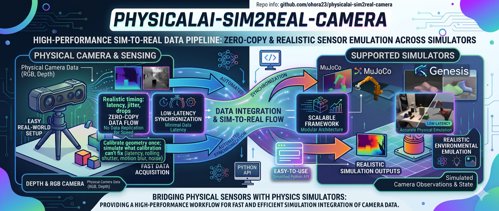
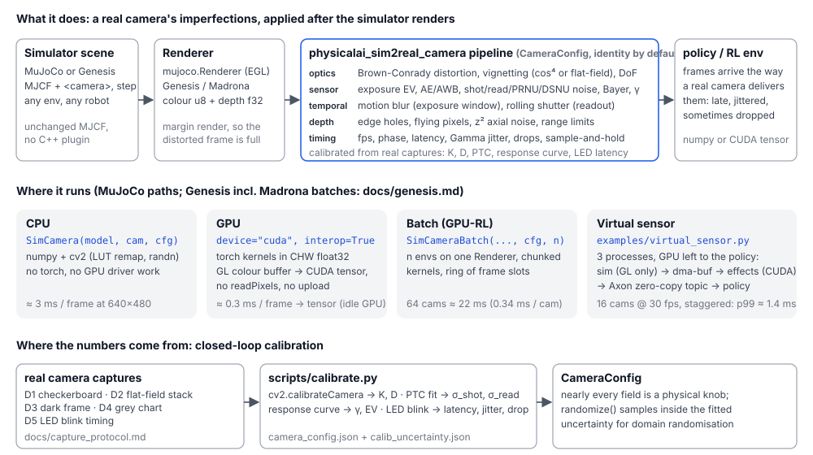
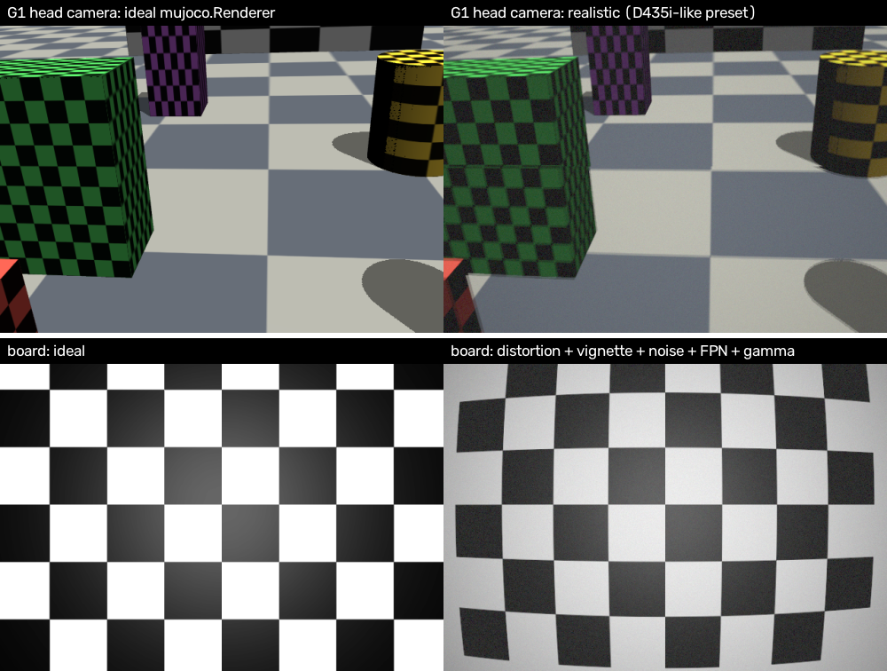

# physicalai-sim2real-camera

**[Project page](https://ohora23.github.io/physicalai-sim2real-camera/)** · **[White paper (Genesis)](https://ohora23.github.io/physicalai-sim2real-camera/whitepaper/genesis/)**

<p align="center"></p>

Make the camera of your Physical AI simulator behave like the real one on your robot: lens distortion,
vignetting, sensor noise, motion blur, rolling shutter, depth artefacts, and frames that arrive late, jittered
and sometimes not at all. Nearly every parameter is a physical knob, and the knobs can be fitted from captures of
the real camera. MuJoCo and Genesis are supported today; the image pipeline itself does not depend on the
simulator, so another renderer only has to hand over its frames.
Development continues on MuJoCo; the Genesis backend is kept as it is and guarded by its tests (status, what it
adds on top of Genesis and what it does not support: [`docs/genesis.md`](docs/genesis.md#status-and-direction-2026-11-20);
English white paper with figures and videos: [`docs/whitepaper/genesis/index.html`](docs/whitepaper/genesis/index.html)).

<p align="center"></p>

<p align="center"></p>

## Supported simulators

| simulator | camera class | how frames get in | status |
|---|---|---|---|
| MuJoCo | `SimCamera`, `SimCameraBatch` | wraps `mujoco.Renderer`; extra renders for effects that need them | complete: CPU / GPU / batch paths, scene DR, gym wrapper, virtual sensor, calibration and online observer |
| Genesis | `genesis_bridge.GenesisCamera` | Genesis renders in a kinematic mirror scene (OpenGL rasterizer, or Madrona BatchRenderer with frames kept on the GPU); frames go through `SimCameraBatch(renderer=False)` | window mode, depth, floating base, batched envs (Madrona: 1.1 ms / env at 256 envs), camera-following headlight; validated against MuJoCo ([`docs/genesis.md`](docs/genesis.md)) |
| any other renderer | `SimCameraBatch(model, cam, cfg, n, renderer=False)` | `ingest(i, rgb[, depth], capture_t=...)` per camera, or `accumulate_all` / `ingest_all` + `claim_all` for all cameras at once, with the margin render `H_r x W_r` at `fovy_r` | the entry point the Genesis backend is built on |

The camera itself is described by an MJCF camera in every case (MuJoCo loads it, Genesis loads the same MJCF): its
pose, `fovy` / `sensorsize` and the scene's `zfar` give the intrinsics, the distortion margin and the depth range, so
one `CameraConfig` means the same camera in every simulator.

## Why a post-process and not a simulator plugin

- A camera sensor of a simulator draws one instant of the scene. Motion blur and rolling shutter need several
  instants inside one exposure, which only a layer around the renderer can provide.
- MuJoCo's native plugin API (3.14) has ACTUATOR / PASSIVE / SDF / SENSOR capabilities only; a SENSOR plugin
  writes scalars into `sensordata` during `mj_step` and cannot render. Genesis' camera sensors render the ideal
  image and refuse the generic sensor `delay` / `jitter` options.
- Everything downstream of the render is pixel arithmetic: numpy and cv2 on the CPU, torch kernels on the GPU.
  Python only sequences those calls; the hot loops run in cv2 / numpy (C++) and torch CUDA kernels. That part is
  shared by every simulator.

## What it models

Every effect is identity by default: `CameraConfig(width, height)` passes pixels through unchanged
(`CameraStream` still delivers at `fps` = 30). Each row is a group of `CameraConfig` fields; the last column says
which paths support it ("all" = MuJoCo `SimCamera` on CPU or GPU, `SimCameraBatch`, and Genesis, which runs on
`SimCameraBatch`).

| stage | effects | config fields | paths |
|---|---|---|---|
| intrinsics | pinhole from the MJCF camera (`sensorsize` + `focal`, else `fovy`), or your own K | `fx fy cx cy`, `intrinsics_from_model()` | all |
| optics | Brown-Conrady distortion (OpenCV order) with a margin render so the frame stays full, cos⁴ or measured flat-field vignetting, depth of field, lens PSF / OLPF / pixel-aperture blur as one Gaussian | `dist`, `vignette`, `flat_field`, `focus_m`, `aperture_m`, `psf_sigma_px` | all |
| supersampling | render at `render_scale` x the resolution and area-average in linear light | `render_scale` | MuJoCo `SimCamera` (no interop) |
| exposure | EV offset, auto-exposure and auto-white-balance with time constants | `exposure_ev`, `ae_tau_s`, `ae_target`, `awb_tau_s` | all |
| sensor | shot + read noise, PRNU / DSNU fixed-pattern noise, black level, Bayer mosaic + demosaic, gamma, uint8 quantisation | `sigma_shot sigma_read sigma_prnu sigma_dsnu`, `black_level`, `bayer`, `gamma` | all |
| temporal | motion blur over the exposure window, rolling shutter by readout band | `exposure_s`, `blur_samples`, `readout_s`, `rs_bands` | all |
| mount | camera-mount vibration: a resonant random process per axis, seen by every sub-render; opt-in, in no preset ([`docs/vibration.md`](docs/vibration.md)) | `mount_vib_rot_deg mount_vib_trans_m`, `mount_vib_hz mount_vib_zeta` | all |
| depth | edge holes and flying pixels, z²-scaled axial noise, min / max range | `depth_edge_hole_px`, `depth_sigma_a depth_sigma_b`, `depth_min_m depth_max_m` | all |
| timing | frame rate and phase, latency, Gamma-distributed jitter, frame drops, sample-and-hold delivery to the control loop | `fps phase_s latency_s jitter_k jitter_theta drop_prob` | all |
| environment × camera | sensor colour matrix, mains light flicker per row (bands under a rolling shutter), lens dust / smudges with veiling glare | `ccm`, `flicker_amp flicker_hz flicker_phase`, `dirt_density dirt_scatter` | all |
| transport | MJPEG compression | `jpeg_quality` | MuJoCo `SimCamera` on the CPU |
| scene (render time) | light gain / tint / ambient, extra lamps (spot, window) with shadows, people walking past who cast shadows, stains on surfaces, material colour jitter; edits the `MjvScene` only, physics untouched | `scene_dr.SceneConfig`, `Lamp`, `Walker` | MuJoCo |

Latency is measured mid-exposure → frame available to the policy, the same reference point as the LED
test used on the real camera, so a fitted number drops straight into the config.

## Install

Linux with EGL (`MUJOCO_GL=egl`, headless). The GPU paths need a CUDA build of torch.

```bash
git clone https://github.com/ohora23/physicalai-sim2real-camera.git && cd physicalai-sim2real-camera
python -m venv .venv && .venv/bin/pip install -e ".[gpu,dev]"   # drop [gpu] for the CPU-only package
git config core.hooksPath .githooks                                # pre-push gate (lint + full suite)
```

Core dependencies are `mujoco`, `numpy` and `opencv-python-headless` only (`mujoco` also reads the MJCF camera for
the other simulators). Genesis goes in its own venv, because it pulls mujoco 4 and opencv-python:

```bash
uv venv -p 3.12 .venv-genesis
uv pip install -p .venv-genesis torch --index-url https://download.pytorch.org/whl/cu128
uv pip install -p .venv-genesis genesis-world==1.4.5 mujoco==3.14.0 pytest pytest-cov
uv pip install -p .venv-genesis --no-deps -e .
```

## Quickstart

MuJoCo:

```python
import mujoco
from physicalai_sim2real_camera import CameraConfig, CameraStream, SimCamera

cfg = CameraConfig(640, 480,
                   dist=(-0.3, 0.1, 0.001, -0.001, 0.0), vignette=1.0, exposure_ev=-0.3,
                   sigma_shot=0.02, sigma_read=0.005, sigma_prnu=0.02, sigma_dsnu=0.005,
                   black_level=0.02, gamma=2.2,
                   fps=30, latency_s=0.05, jitter_k=2, jitter_theta=0.005, drop_prob=0.05)

cam = SimCamera(model, "cam", cfg)          # wraps a mujoco.Renderer for camera "cam"
rgb = cam.render(data)                      # uint8 (H, W, 3), as the real camera would deliver it
rgb, z = cam.render(data, depth=True)       # plus float32 depth in metres, same distortion

stream = CameraStream(cam, cfg)             # fps / latency / jitter / drops, driven by sim time
for _ in range(1000):
    mujoco.mj_step(model, data)             # 500 Hz control loop (timestep 0.002)
    frame, capture_t, n = stream.step(data) # what the policy sees now; frame is None until the first capture
```

Genesis (same `cfg`, same MJCF camera):

```python
import types

import genesis as gs
from physicalai_sim2real_camera import CameraStream
from physicalai_sim2real_camera.genesis_bridge import GenesisCamera

gs.init(backend=gs.gpu)
scene = gs.Scene(sim_options=gs.options.SimOptions(dt=0.002))
robot = scene.add_entity(gs.morphs.MJCF(file=xml))
cam = GenesisCamera(xml, "cam", cfg, dt=0.002)   # builds its own mirror scene; the physics scene is only read
scene.build()

stream = CameraStream(cam, cfg)
for _ in range(1000):
    scene.step()
    frame, capture_t, n = stream.step(types.SimpleNamespace(time=scene.sim.cur_t, qpos=robot.get_qpos()))
```

`frame` changes only when a new capture becomes available, `capture_t` is its mid-exposure time, so
`time - capture_t` is the age the policy actually sees. For a batched Genesis scene pass `n_envs=n` and the
`(n, nq)` qpos; for MuJoCo-like lighting in Genesis pass `headlight=...` and a `vis_options` (see
[`docs/genesis.md`](docs/genesis.md)).

## Execution paths

| simulator | path | API | when | measured (RTX 5080, idle GPU) |
|---|---|---|---|---|
| MuJoCo | CPU | `SimCamera(model, cam, cfg)` | one camera, no torch in the process | ≈ 3.2 ms / frame (640×480) |
| MuJoCo | GPU | `SimCamera(..., device="cuda", interop=True)`, `render(..., as_tensor=True)` | the frame is going to a CUDA policy anyway; interop takes the GL colour buffer straight into CUDA | ≈ 0.3 ms / frame (640×480) |
| MuJoCo | batch | `SimCameraBatch(model, cam, cfg, n)` (import it by name, it loads torch): `render_into(i, data_i)` per env, one `process()` | n vectorised envs on one Renderer, kernels chunked, ring of frame slots | 64 cams ≈ 22 ms (0.34 ms / cam) |
| MuJoCo | virtual sensor | `examples/virtual_sensor.py` | the policy owns the GPU: a GL-only sim process exports frames by dma-buf to a CUDA effects process, which publishes on an [Axon](https://github.com/ohora23/Axon_SDK_for_PhysicalAI) zero-copy topic | 16 cams at 30 fps with `--stagger`: publish lateness p99 ≈ 1.4 ms |
| Genesis | single | `GenesisCamera(xml, cam, cfg, dt)` | a Genesis scene; the mirror scene renders the margin view | G1, window mode (13 sub-renders + depth, 656×494): ≈ 25 ms / capture |
| Genesis | batched | `GenesisCamera(..., n_envs=n)` | a batched Genesis scene; env i equals a single camera with `cfg.seed + i` bit for bit | same scene: 11.3 ms / env at n = 4, 7.2 ms / env at n = 16 |
| Genesis | Madrona | `GenesisCamera(..., n_envs=n, renderer="madrona", compile=True)` | large batches: every env in one GPU pass, frames never leave the GPU, all cameras accumulated at once | same scene: 2.10 ms / env at n = 16, 1.22 at 64, 1.12 at 256 |

`CameraStreamBatch(cfg, n, phase_s=stagger_phases(cfg, n))` gives every camera of a batch its own
timing state and spreads their capture phases so at most one fires per control tick. Numbers, method
and the variants that were tried and rejected are in [`docs/perf.md`](docs/perf.md) and
[`docs/genesis.md`](docs/genesis.md); the GPU-RL topology is explained in [`docs/gpu_rl_design.md`](docs/gpu_rl_design.md).

## Agreement between simulators

The same camera config in MuJoCo and Genesis gives the same images up to the renderers' own shading. Measured on the
WIRobotics ALLEX head camera and a Unitree G1 with a free-joint pelvis ([`docs/genesis.md`](docs/genesis.md)):

| check | result |
|---|---|
| window-mode (motion blur + rolling shutter) silhouettes, ALLEX `demo1` | IoU median 0.988 |
| window-mode silhouettes, G1 yawing at 2.5 rad/s | IoU median 0.995, centroid difference 0.46 px |
| checkerboard K / D recovered through each pipeline | fx / fy within 0.14 %, corners within 0.70 px of each other |
| depth on targets | median difference 0.15 mm |
| physics with the Genesis camera on vs off | identical trajectories |
| ideal brightness / AE gain with `--headlight` lights, whole `demo1` turning segment | +0.1 % / +1.7 % |

## Calibrating against a real camera

### Only intrinsics and extrinsics calibrated (the usual robot setup)

Most robot stacks calibrate K, D and the camera mount, and correct the geometry before the policy sees a frame,
but never measure the rest. The `calibrated` preset is that setup: the geometry is yours, and everything a
calibration does not reach is on at typical values (sensor noise, vignetting, auto exposure, motion blur,
rolling shutter, latency, jitter, drops, depth noise / holes / range), so the policy and your frame handling
meet it in simulation. This is where the simulation earns its keep: a calibration fixes the geometry once, but
latency, rolling shutter and motion blur change with every frame and every head motion, and noise, auto
exposure and drops come from the sensor and the transport, so no calibration step removes them; they have to be
handled (by the policy, a timestamp-aware controller, a filter), and that handling can be developed here:

```python
from physicalai_sim2real_camera import CameraConfig, set_extrinsics

cfg = CameraConfig.preset("calibrated", 640, 480, K=K)           # rectified frames (cv2.undistort / image_proc)
cfg = CameraConfig.preset("calibrated", 640, 480, K=K, dist=D)   # raw frames: the measured distortion stays in
set_extrinsics(model, "head_cam", T_body_cam)                    # OpenCV optical frame, in the camera's parent body
```

`T_body_cam` is the calibrated `(4, 4)` camera pose in the frame of the MJCF body the camera hangs from; for
Genesis pass `GenesisCamera(..., extrinsics=T_body_cam)`. The typical values (`config.TYPICAL_UNCALIBRATED`) are
VIRTUAL placeholders for a D435i-class camera, not a measurement: randomise around them with `calib.randomize()`,
override any field you know (`preset(..., latency_s=0.045)`), or replace them with the fit below.

A calibrated mount still moves: residual calibration error, and flex and settling that differ between units and
over time. Per episode, `perturb_extrinsics(T_body_cam, rng)` draws a mount pose around the calibrated one (up to
0.5 deg and 3 mm per axis by default, placeholders); apply it with `set_extrinsics` (MuJoCo) or
`GenesisCamera.set_extrinsics` (Genesis). `examples/genesis_allex.py --cfg calibrated` runs the preset on ALLEX, `examples/genesis_apollo.py` on Apptronik Apollo.

### Full calibration

The config fields are physical, so they can be fitted. [`docs/capture_protocol.md`](docs/capture_protocol.md)
is the one-session capture checklist (checkerboard, flat / dark fields, grey chart, noise stack, LED
blink), and `scripts/calibrate.py` turns the captures into a `camera_config.json` plus an uncertainty
file:

```bash
.venv/bin/python scripts/calibrate.py calib_data --out camera_config.json --report calib_report
```

Under the hood: `cv2.calibrateCamera` for K and D, a photon-transfer-curve fit for the shot and read
noise, a response-curve fit for gamma and exposure, and LED on / off timing for latency, jitter and
drops (`physicalai_sim2real_camera/calib_geom.py`, `calib_photo.py`, `calib_timing.py`). `calib.randomize()`
samples a config inside the fitted uncertainty for domain randomisation. The whole loop is validated
without hardware: synthetic captures from a known config must fit back to that config. The fitted config is
simulator-independent: the same `camera_config.json` drives the MuJoCo and the Genesis camera.

### Online observer

After the offline fit, the camera can keep being estimated while the robot moves
([`docs/observer.md`](docs/observer.md)). A ChArUco prism with a grey wedge (`scripts/make_prism.py`) gives the
observer K and distortion, shot / read noise and latency / jitter / drops, each with an uncertainty;
`calib.estimate_to_config` feeds two disjoint windows back into the config and its randomisation spread only when
they agree. Validated in MuJoCo (20 seeds, both shutters: focal length 0.3 %, principal point 2.3 px,
latency 2 ms, every |error| / σ ≤ 3) and by feeding the estimate back and re-estimating it (a fixed point in 90-100 %
of trials, the truth inside the fed-back DR in all). Recordings (synthetic so far) replay through the same code
(`scripts/observe.py`, capture protocol D7); `examples/virtual_sensor.py --scene prism --observer` runs it live.

### Gymnasium envs (LeRobot gym-hil, MuJoCo)

`RealSensorWrapper(env, {"wrist": ("handcam_rgb", cfg), ...}, substep_module=...)`
(`physicalai_sim2real_camera/gym_wrapper.py`, extra `[gym]`) replaces a MuJoCo env's ideal `obs["pixels"]` with
`SimCamera` + `CameraStream` frames, keeps the ideal ones in `info["ideal_pixels"]` and reports each frame's
age in `info["camera_age_s"]`. With `substep_module=gym_hil.mujoco_gym_env` the streams step after every
physics step (2 ms), so a 30 fps camera captures three frames inside one 10 Hz gym-hil control step and the
policy sees the newest delivered one. gym-hil pins MuJoCo < 3.9, so it runs in its own venv (`.venv-hil`;
setup in `examples/gym_hil_sensor.py`).

## Examples and scripts

| simulator | file | what it shows |
|---|---|---|
| MuJoCo | `examples/demo.py` | ideal vs realistic board render and a 2 s timing log |
| MuJoCo | `examples/g1_walk.py` | Unitree G1 head camera (D435i-like preset) on a prescribed walking trajectory; frames and a strip (`docs/g1_demo.md`) |
| MuJoCo | `examples/axon_bridge.py` | `CameraStream` frames over an Axon topic with age logging (`docs/axon_bridge.md`) |
| MuJoCo | `examples/dmabuf_bridge.py` | GL-only sim process → dma-buf → CUDA receiver, bit-exact |
| MuJoCo | `examples/gym_hil_sensor.py` | gym-hil Franka pick-cube with realistic front + wrist cameras: ideal vs real strip and frame ages (`.venv-hil`) |
| MuJoCo | `examples/virtual_sensor.py` | the three-process virtual sensor with per-note timers and lateness summary; `--scene prism --observer` adds the live observer |
| Genesis + MuJoCo | `examples/genesis_allex.py` | WIRobotics ALLEX head camera in Genesis (`GenesisCamera`) or MuJoCo: recorded-motion replay, captures, `--video`, `--live`, `--headlight` (`docs/genesis.md`) |
| Genesis + MuJoCo | `examples/genesis_apollo.py` | Apptronik Apollo head camera (mounted on the neck) in Genesis or MuJoCo: scripted neck scan, fast turns and an arm wave in front of a table; `--cfg calibrated` / per-effect cfgs, `--video`, `--preview` |
| Genesis + MuJoCo | `scripts/genesis_allex_check.py` | agreement: window-mode silhouettes, blur, depth, physics untouched, lights per segment, checkerboard K / D |
| Genesis + MuJoCo | `scripts/genesis_g1_check.py` | floating base: G1 head camera on a yawing free-joint pelvis; `bench` for batched Genesis throughput |
| any | `scripts/bench_batch.py` | `SimCameraBatch` bench, markdown table out |
| any | `scripts/calibrate.py` | capture directory → config + uncertainty + report |
| any | `scripts/make_prism.py` | ChArUco prism target (faces, grey wedge, MJCF + `prism.json`) |
| MuJoCo | `scripts/observe_sim.py` | online observer in the simulator: 20-seed statistics, O8 agreement, `--closure` feedback loop |
| any | `scripts/observe.py` | online observer on a recording (D7 layout) |

The G1, Apollo and D435i assets come from mujoco_menagerie (`scripts/fetch_menagerie.sh`), the WIRobotics ALLEX model from
`scripts/fetch_allex.sh` (pinned; its meshes are not redistributable); Axon is built by `scripts/build_axon.sh`. All
land in `third_party/` and are not committed.

## Development

```bash
make lint   # ruff: errors, import order, Google-style docstrings on public API
make test   # full suite, MUJOCO_GL=egl, GPU required (Genesis tests skip without Genesis)
make cov    # suite + line / branch coverage, gate at 90 %
MUJOCO_GL=egl PYTEST_DISABLE_PLUGIN_AUTOLOAD=1 .venv-genesis/bin/python -m pytest tests/test_genesis_bridge.py
```

Rules are in [`CONTRIBUTING.md`](CONTRIBUTING.md): a branch and a PR per task, tests with explicit
tolerances plus unit tests for pure functions, docstrings on everything public, and the pre-push hook as
the CI (GitHub runners have no GPU or EGL). Hardware the numbers were measured on: RTX 5080, MuJoCo
3.14, Genesis 1.4.5, Python 3.12.

## Documentation

| doc | contents |
|---|---|
| [`docs/genesis.md`](docs/genesis.md) | Genesis backend (`genesis_bridge.GenesisCamera`): design, setup, floating base, batched envs, headlight, measured agreement with MuJoCo |
| [`docs/perf.md`](docs/perf.md) | every optimisation stage with before / after tables: CPU pass, GPU backend, interop, batch, stagger, virtual-sensor per-note cost, live observer A/B |
| [`docs/gpu_rl_design.md`](docs/gpu_rl_design.md) | why the sim should leave the GPU to the policy, and what each topology costs |
| [`docs/observer.md`](docs/observer.md) | online camera observer: target, estimators, feedback gate, accuracy, how to run |
| [`docs/capture_protocol.md`](docs/capture_protocol.md) | real-camera capture checklist for calibration (D1-D5) and for observer recordings (D7) |
| [`docs/g1_demo.md`](docs/g1_demo.md) | G1 head-camera demo (MuJoCo) and what its motion is (and is not) |
| [`docs/axon_bridge.md`](docs/axon_bridge.md) | Axon build and binding notes |

## Status

RGB and depth cameras are complete through calibration, the GPU / batch paths, the three-process
virtual sensor and the online observer with feedback into the config, in MuJoCo. The Genesis backend
covers the image pipeline, window mode, depth, floating bases, batched envs and a camera-following headlight, and
agrees with MuJoCo within the numbers above. Planned next: a real recording of the target camera through the
observer (D7), carrying the capture timestamp through Axon's `TensorDescriptor`, capacity beyond 16 cameras per
2 ms tick, real captures of the target camera (lens flare stays out of scope until there is data for it), and
further simulators through the same `ingest` entry point. The package name is deliberately generic: IMU, LiDAR
and other sensors would follow the same pattern, one module each.

## License

Apache License 2.0, see [`LICENSE`](LICENSE) and [`NOTICE`](NOTICE). Robot models, meshes and textures under
`third_party/` are not part of the repository; each keeps its own license (MuJoCo Menagerie models carry
per-model licenses; the WIRobotics ALLEX meshes are not redistributable), so fetch them from their sources.
